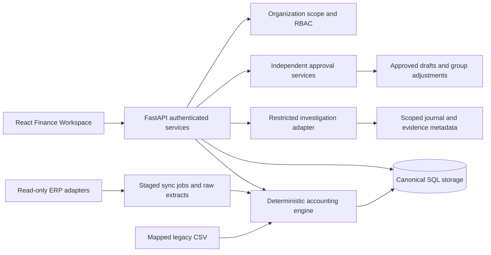

# Architecture and engineering boundaries

Organizations, users and opaque expiring sessions establish access. Client tenant headers are ignored. Business records carry organization IDs, and composite foreign keys reject references to another organization's entities, journals, accounts, users or evidence. API lookups also enforce organization scope. PostgreSQL RLS read policies are still a production requirement; composite keys alone do not prevent an accidentally unscoped SELECT.

Source records, balanced journals and lines, documents, analysis snapshots and events are append-only through ORM services. Financial revisions create a new source version and link to the superseded journal. Reports use active versions. This is not WORM storage: database administrators can modify underlying facts; hashes and audit verification detect changes only while their reference hashes remain trustworthy.

Accounts classify asset/liability/equity/revenue/expense and map to group codes. Local monetary values persist as exact decimal text in SQLite and NUMERIC(20,2) in PostgreSQL. All report and scenario arithmetic uses Decimal. P&L uses monthly movement; balance sheets use cumulative imported entries and unclosed earnings. Source completeness, opening balances and closing entries must be verified by the finance team.

Proposals require a different authorized reviewer and use a conditional database transition to prevent repeat decisions. Approved journal drafts are exported; no ERP posting is implemented. Group elimination drafts are restricted to exact reciprocal claims, are independently reviewed, and can be applied only to matching group/period/FX/source snapshots. Overlapping approved proposals are rejected.

Hash-chain events record the actor and resource. PostgreSQL row locks serialize an organization's event creation. SQLite is intended for a single application writer. External hash anchoring, archival signatures and distributed transactions are not implemented.

The sync worker polls durable queued jobs. Each step performs a bounded page fetch, stages its raw payload and advances a checkpoint. Failed normalization never creates balancing fiction. Single-worker execution is required in this release; Temporal or equivalent orchestration is a next milestone, not an installed empty service.

The model adapter receives pre-scoped facts, has no SQL/posting tools and returns structured narratives with valid evidence references. The financial engine owns all arithmetic. Content grounding does not prove a narrative is correct; labeled finance-domain evaluation remains necessary.

The default local database is separate from the original starter database. The Alembic baseline creates new tables; it does not repair a previously created development schema. Existing deployments need reviewed follow-up migrations and backup/restore testing before upgrade.
